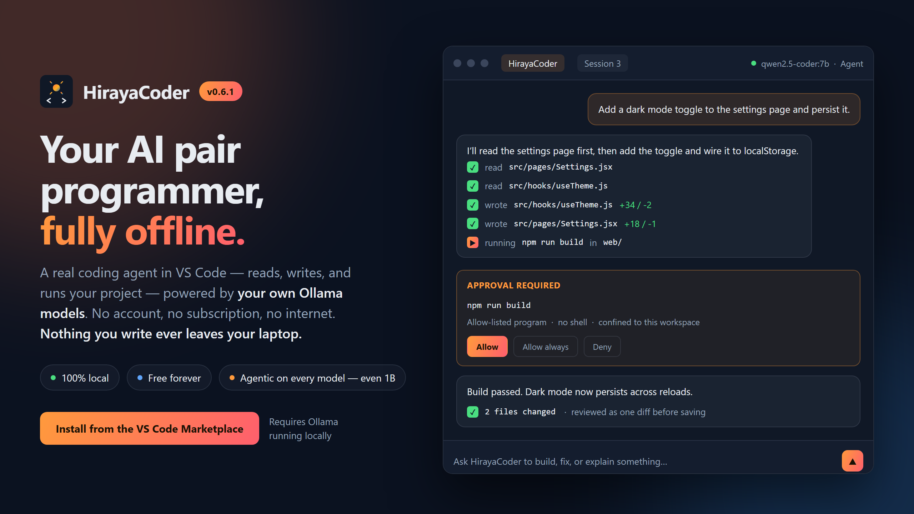
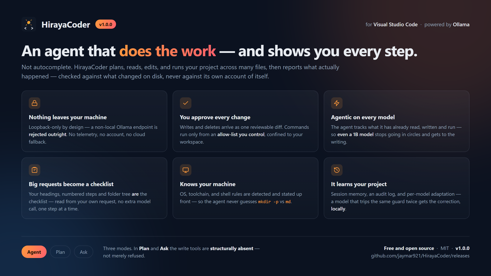

# HirayaCoder

<p align="center">
  
</p>

<p align="center">
  
</p>

*A local Filipino-inspired AI coder that brings imagination and speed to your VS Code workflow.*

**HirayaCoder is a free AI coding assistant that runs entirely on your own computer.**
You type what you want in plain English, and it writes and edits the files for you. No
account, no subscription, no internet connection, and nothing you write ever leaves your
laptop.

> **Hiraya** (Filipino): imagination, aspiration, the spark of an idea before it becomes real.

> **Not on the Marketplace yet.** Releases are published as a `.vsix` on the
> [Releases page](https://github.com/jaymar921/HirayaCoder/releases) and installed with
> one command. See [step 4](#quick-start).

---

## What it does

You open a folder, type *"make me a webpage with a to-do list"*, and it creates the
files, writes the code, and shows you every change before saving anything. Then you keep
talking to it: *"make the buttons blue"*, *"add a delete button"*.

<p align="center">
  
</p>

It runs the AI model on your own hardware through [Ollama](https://ollama.com), so it
works with your Wi-Fi switched off. That is the whole point of it.

---

## New in 1.2.0: small models can change your files

Ask a small model to *"change the tax rate from 8% to 10% in src/cart.js"* and, until
this release, it usually failed. It knew how to write the new line. What it could not do
was point at the old one precisely enough for the change to be made.

So now HirayaCoder finds the right lines itself, shows them to the model, and asks in
plain words for the rewritten version. Before anything is saved it checks the answer: no
existing check was dropped, nothing refers to something that does not exist, and the rest
of the file is untouched. You still approve the change as before.

On our tests with `llama3.2:1b`, the smallest model we support, edits to an existing file
went from **0 out of 12 to 12**, and from **0 to 9** on a second
set of tests written afterwards to check it was not just tuned to the first.

Also in this release:

- **It no longer loses the start of long requests.** Ollama, the program that runs the
  model, was quietly cutting off the beginning of anything long, which is where your
  instructions were. HirayaCoder now tells it how much to keep. If you have memory to spare, you can raise it with the
  `hirayacoder.ollama.contextLength` setting.
- **You can see what the model was given.** Under each reply there is a line saying how
  much of the model's memory the turn used, and a closed **What it remembered** panel
  with exactly what it was told about your project. When an answer is wrong, this tells
  you whether it had the wrong picture or just reasoned badly.
- **It remembers what it built.** After it writes a function, later requests are told
  its name and what it takes, so *"now use it from the main page"* calls it correctly.
- **A tidier panel.** The settings are grouped into two rows, and the ones you rarely
  touch are quieter.

**Using a 3B model like `llama3.2`?** It is just big enough to get the other, more
general way of working, which in our tests managed 2 edits out of 16. Add
`"hirayacoder.model.tierOverrides": { "llama3.2:latest": "B" }` to your settings and it
passed all 16 instead.

Still new from 1.1.0: attach a screenshot or a photo and it reads it, even if your coding
model only handles text. See
[IMAGE-RECOGNITION.md](https://github.com/jaymar921/HirayaCoder/blob/main/doc/IMAGE-RECOGNITION.md).

---

## Limitations

Read this part. It is the honest description of the tool, and it will save you an
evening if this is not what you need.

**It is not as clever as a paid cloud assistant.** It runs a small model on your own
hardware. Small models handle ordinary, specific tasks well and vague, large ones badly.
Ask for one page, one feature, or one fix at a time and it does a decent job. Ask for
"a full social media app" and you will be disappointed.

**It does not finish a whole application.** This is measured, not guessed. On a brief for
a complete React app, a small model scaffolds the project, writes every file you named,
and installs the dependencies. Then the build fails, and no model at this size finished
the app in any of our test runs.

**It is slow.** On a 16 GB laptop with no graphics card, expect one to five minutes for
an ordinary task. A graphics card makes it faster, not smarter. A bigger model makes it
smarter, not faster.

**It never goes online.** No cloud models, no looking things up, no fetching
documentation. The only address it will connect to is your own machine.

**It cannot leave the folder you opened,** and it only runs commands from a fixed list
(`node`, `npm`, `git`, `pytest` and about twenty more). There is no shell, so `&&`, `|`
and `>` are refused rather than interpreted.

**Small models make specific mistakes.** They repeat themselves, they report success
having written nothing, and they occasionally write a file that parses fine but has an
export deleted. There are checks for each of these, and the checks catch most of it
rather than all of it.

**Image reading is approximate.** Large text and obvious subjects are reliable. Small
text in a screenshot, exact numbers, and precise layout are not, and a misread arrives
as a confident paragraph rather than as an apology.

The full version, including everything that is a deliberate design choice rather than a
shortcoming, is in
[LIMITATIONS.md](https://github.com/jaymar921/HirayaCoder/blob/main/doc/LIMITATIONS.md).

---

## Will it run on my computer?

The question that matters is **how much RAM you have**. You do not need a graphics card.

| Your computer | Will it work? | What to expect |
|---|---|---|
| 8 GB RAM | Just barely | Slow, simple single-file tasks only |
| 16 GB RAM, no graphics card | **Yes, this is what it was built for** | A task takes 1 to 5 minutes |
| 16 GB+ with a gaming graphics card | Comfortably | A task takes 20 to 60 seconds |
| Mac with Apple Silicon (M1 to M4) | Very well | A task takes 10 to 30 seconds |

To check on Windows: press `Ctrl+Shift+Esc`, click **Performance**, then **Memory**. On
a Mac: Apple menu, then **About This Mac**.

---

## Quick start

Four steps. The
[full walkthrough](https://github.com/jaymar921/HirayaCoder/blob/main/doc/GETTING-STARTED.md)
explains each one properly if you want it.

**1.** Install [VS Code](https://code.visualstudio.com), version 1.85 or newer.

**2.** Install [Ollama](https://ollama.com) and leave it running. It has no window. It
just sits in your system tray, and that is normal.

**3.** Download a model. Open a terminal and paste one line:

```bash
# 16 GB RAM or more, the best all-round choice. Reads images too
ollama pull gemma4:e2b

# 8 GB RAM, or if the above is too slow
ollama pull llama3.2:1b
```

**4.** Download the `.vsix` from the
[Releases page](https://github.com/jaymar921/HirayaCoder/releases) and install it:

```bash
code --install-extension hirayacoder-<version>.vsix
```

Then open a folder in VS Code (this is required, it refuses to work without one), press
`Ctrl+Shift+H`, and type something. Good first tries:

- `make a webpage that says hello with a big blue button`
- `create a simple to-do list app in one HTML file`
- `explain what this project does`

There is a **Guide** button in the chat header that repeats all of this from inside the
extension.

---

## The three modes

There is a row of buttons at the top of the chat. Agent is the default and is what you
want most of the time.

| Mode | Use it when |
|---|---|
| **Agent** | You want it to write or change files. The normal choice |
| **Plan** | You want to see what it *would* do first, without it touching anything |
| **Ask** | You just have a question |

You do not have to switch to Ask to ask something. If you say "hello" or "what does this
file do", Agent mode notices and just answers.

---

## Your privacy

This is the main reason to choose this over the alternatives, so it is worth being blunt.

- **Nothing you type or open is sent anywhere.** The extension only ever talks to
  `127.0.0.1`, which is your own computer. A non-local address is rejected in the code
  itself, before any connection is opened.
- **No account, no sign-up, no telemetry.** Nobody is counting your keystrokes.
- **It works with your Wi-Fi off.** Try it. That is the proof.
- **The AI cannot leave your folder.** Every file operation is confined to the folder
  you opened.
- **No third-party code ships in the extension.** Zero production dependencies.

Full detail in
[SECURITY.md](https://github.com/jaymar921/HirayaCoder/blob/main/doc/SECURITY.md).

---

## Documentation

| | |
|---|---|
| [Getting started](https://github.com/jaymar921/HirayaCoder/blob/main/doc/GETTING-STARTED.md) | The complete first-run walkthrough |
| [Using it day to day](https://github.com/jaymar921/HirayaCoder/blob/main/doc/USING-IT.md) | Modes, watching a run, and the habits that make small models work |
| [Reading images](https://github.com/jaymar921/HirayaCoder/blob/main/doc/IMAGE-RECOGNITION.md) | Attaching screenshots and photos |
| [Limitations](https://github.com/jaymar921/HirayaCoder/blob/main/doc/LIMITATIONS.md) | What it cannot do, by design and otherwise |
| [Troubleshooting](https://github.com/jaymar921/HirayaCoder/blob/main/doc/TROUBLESHOOTING.md) | When something goes wrong |
| [Choosing a model](https://github.com/jaymar921/HirayaCoder/blob/main/doc/CHOOSING-A-MODEL.md) | Which one to download, in plain language |
| [Tutorial](https://github.com/jaymar921/HirayaCoder/blob/main/doc/TUTORIAL.md) | A longer, friendlier walkthrough |

**For developers:**
[Developing](https://github.com/jaymar921/HirayaCoder/blob/main/doc/DEVELOPING.md) ·
[Architecture](https://github.com/jaymar921/HirayaCoder/blob/main/doc/ARCHITECTURE.md) ·
[Features and settings](https://github.com/jaymar921/HirayaCoder/blob/main/doc/FEATURES.md) ·
[Measurements](https://github.com/jaymar921/HirayaCoder/blob/main/doc/MODELS.md) ·
[Security model](https://github.com/jaymar921/HirayaCoder/blob/main/doc/SECURITY.md) ·
[Benchmarks](https://github.com/jaymar921/HirayaCoder/blob/main/benchmarks/README.md)

---

## Building from source

Needs Node.js 18 or newer.

```bash
npm install
npm run test:all     # lint + unit + integration, against a real VS Code
npm run package      # builds builds/v<version>/hirayacoder-<version>.vsix
```

Contributions are welcome, with one hard rule: **pull requests only, never push directly
to `main`.** Read
[CONTRIBUTING.md](https://github.com/jaymar921/HirayaCoder/blob/main/CONTRIBUTING.md)
first, and see
[DEVELOPING.md](https://github.com/jaymar921/HirayaCoder/blob/main/doc/DEVELOPING.md)
for what is worth knowing before you change the agent loop.

---

## Built from an AI prompt

This project was scaffolded from a single structured specification designed for AI
coding agents. See
[PROMPT.md](https://github.com/jaymar921/HirayaCoder/blob/main/setup/PROMPT.md) for the
full build order, feature list, and security requirements.

## Author

Built by [**jaymar921**](https://github.com/jaymar921). Practical, resourceful, and made
for real hardware rather than top-spec dev machines.

## License

Licensed under the terms in
[LICENSE](https://github.com/jaymar921/HirayaCoder/blob/main/LICENSE).
